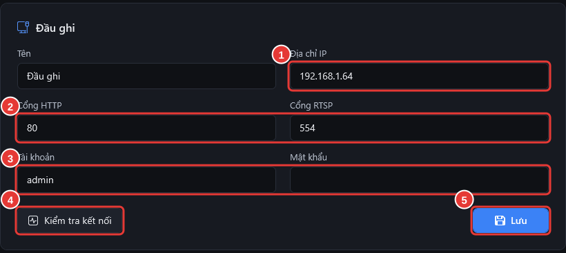

# Kết nối đầu ghi lần đầu

**Ai làm:** Bộ phận IT · **Mất khoảng:** 5 phút (chưa tính chuẩn bị đầu ghi)

## Chuẩn bị trên đầu ghi

Tên mục trong menu đầu ghi có thể khác đôi chút tuỳ firmware.

| Việc cần | Ở đâu trên đầu ghi | Ghi chú |
| --- | --- | --- |
| Bật **RTSP**, cổng 554 | Mạng > Cổng (Port) | Để xem trực tiếp và xem lại |
| Bật giao thức tích hợp (ISAPI) | Mạng > Cài đặt nâng cao > Giao thức tích hợp (Integration Protocol) | Để đọc danh sách camera, tìm ghi hình và tải video |
| Tạo tài khoản riêng cho phần mềm | Quản lý người dùng > Thêm | Chỉ cần quyền xem trực tiếp từ xa (Remote Live View) và xem lại từ xa (Remote Playback), kèm quyền tải video nếu có. Không dùng tài khoản `admin` |
| Bật luồng phụ cho mọi camera | Ghi hình/Mã hoá > Luồng phụ | Lưới camera dùng luồng phụ để máy chạy nhẹ |
| Đồng bộ giờ (NTP), đúng múi giờ | Hệ thống > Thời gian | Giờ lệch thì xem lại và trích xuất video bị lệch giờ |
| Mở cổng HTTP 80 và RTSP 554 từ máy tính tới đầu ghi | Tường lửa, VLAN | Đã đổi cổng trên đầu ghi thì nhập đúng cổng đó |


Đầu ghi Hikvision tạm khoá đăng nhập sau vài lần sai mật khẩu (thường 30 phút). Phần mềm dừng ngay sau lần sai đầu tiên và báo số lần còn lại, nên hãy kiểm tra kỹ mật khẩu trước khi bấm.


## Nhập thông tin đầu ghi

Lần đầu mở, phần mềm vào thẳng trang **Cài đặt** với khung **Kết nối đầu ghi lần đầu**. Các lần sau, bấm biểu tượng bánh răng ở góc trên bên phải để vào lại.

<figure><figcaption>
Khung Đầu ghi trong Cài đặt
</figcaption></figure>



### Điền địa chỉ và tài khoản

| Ô | Điền gì |
| --- | --- |
| **Tên** | Tên dễ nhớ, ví dụ `Đầu ghi tầng 1`. Không bắt buộc đổi. |
| **Địa chỉ IP** (1) | Địa chỉ của đầu ghi trong mạng nội bộ, ví dụ `192.168.1.64`. |
| **Cổng HTTP**, **Cổng RTSP** (2) | Mặc định `80` và `554`. Chỉ sửa nếu đầu ghi dùng cổng khác. |
| **Tài khoản**, **Mật khẩu** (3) | Tài khoản riêng đã tạo cho phần mềm. |



### Kiểm tra kết nối

Bấm **Kiểm tra kết nối** (4). Nếu đúng, dòng **Đã kết nối: DS-7732NI-M4 · 17 camera** hiện ra (model và số camera theo đầu ghi của bạn). Nếu sai, phần mềm hiện lý do; xem mục **Lỗi thường gặp** bên dưới.



### Lưu

Bấm **Lưu** (5). Thông báo **Đã lưu đầu ghi. Đang mở camera…** hiện ra, phần mềm chuyển sang tab **Trực tiếp**.




**Kết quả:** lưới camera hiện ra. Mật khẩu được mã hoá bằng Windows và chỉ đọc được trên đúng máy và tài khoản Windows này. Người xem camera không cần làm gì thêm. Muốn đổi thư mục lưu video hoặc ảnh, xem [Các mục trong Cài đặt](../tham-khao/cac-muc-cai-dat.md).


## Lỗi thường gặp

Không kết nối được đầu ghi … Kiểm tra mạng và địa chỉ IP.

Sai địa chỉ IP hoặc cổng, đầu ghi đang tắt, hoặc mạng không thông. Mở `http://` + địa chỉ IP đầu ghi bằng trình duyệt trên cùng máy: vào được thì kiểm tra lại **Cổng HTTP**; không vào được thì kiểm tra mạng và tường lửa.

Sai tài khoản hoặc mật khẩu đầu ghi. Kiểm tra lại trong Cài đặt.

Gõ sai hoặc mật khẩu đã bị đổi. Dòng báo lỗi cho biết còn bao nhiêu lần thử trước khi đầu ghi tạm khoá. Sửa lại rồi bấm **Kiểm tra kết nối**.

Đầu ghi đang tạm khóa đăng nhập vì nhập sai mật khẩu nhiều lần.

Chờ đúng số phút phần mềm báo, sửa mật khẩu, rồi thử lại. Thử tiếp trong lúc bị khoá chỉ kéo dài thời gian khoá.

Tài khoản này không đủ quyền trên đầu ghi.

Tài khoản thiếu quyền xem trực tiếp, xem lại hoặc tải video. Cấp thêm các quyền đó cho tài khoản trên đầu ghi, rồi bấm **Kiểm tra kết nối** lại.

