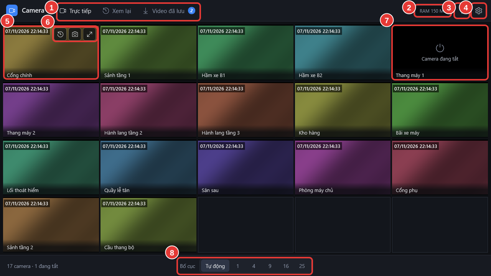

# Làm quen giao diện

Mở phần mềm bằng biểu tượng **Camera Viewer** ngoài màn hình. Phần mềm mở ngay tab **Trực tiếp** với lưới tất cả camera.

<figure><figcaption>
Màn hình Trực tiếp
</figcaption></figure>

| Số | Vùng | Dùng để |
| --- | --- | --- |
| 1 | Ba tab **Trực tiếp**, **Xem lại**, **Video đã lưu** | Chuyển giữa xem trực tiếp, xem lại ghi hình và danh sách video đã lưu. Số trên tab **Video đã lưu** là số video đang lưu. |
| 2 | Ô **RAM** | Bộ nhớ máy tính phần mềm đang dùng. Chỉ để tham khảo. |
| 3 | Dấu hỏi **Hướng dẫn sử dụng** | Mở tài liệu này trong một cửa sổ riêng, đúng trang về màn hình đang xem. Nhấn phím `F1` cũng được. |
| 4 | Bánh răng **Cài đặt** | Dành cho bộ phận IT. Người xem camera không cần vào. |
| 5 | Ô camera | Hình camera, tên camera ở góc dưới bên trái. |
| 6 | Các nút trên ô camera | Hiện khi để chuột lên ô: **Xem lại**, **Chụp ảnh**, **Phóng to**, **Ẩn**. |
| 7 | Ô camera đang tắt | Camera không hoạt động. Xem bảng dưới. |
| 8 | **Bố cục**, **Bộ** và **Camera** | **Bố cục** chọn cách chia ô (thường để **Tự động**). **Bộ** lưu và chuyển giữa các cách sắp xếp. **Camera** mở danh sách camera để kéo vào ô. Xem [Xem tất cả camera](../xem-camera/xem-tat-ca-camera.md). |

## Ô camera báo gì

| Ô hiện | Nghĩa là | Bạn cần làm gì |
| --- | --- | --- |
| Hình camera | Camera đang chạy | Không cần làm gì. |
| **Đang kết nối…** | Phần mềm đang mở camera, thường mất 1–2 giây | Chờ. |
| **Mất kết nối, đang thử lại…** | Camera hoặc mạng vừa bị gián đoạn | Chờ, phần mềm tự kết nối lại. Kéo dài thì báo bộ phận IT. |
| **Camera đang tắt** | Đầu ghi báo camera không hoạt động | Báo bộ phận IT kiểm tra camera. |
| **Không xem được camera này** | Lỗi kéo dài hoặc không có quyền xem | Báo bộ phận IT. |


Thu nhỏ cửa sổ phần mềm thì camera tạm dừng để máy nhẹ hơn; mở lại cửa sổ thì camera tự chạy tiếp.

