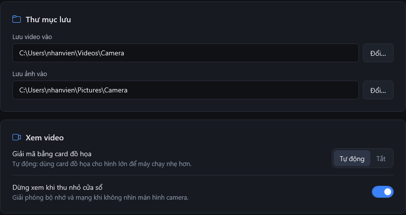

# Các mục trong Cài đặt

Bấm biểu tượng bánh răng ở góc trên bên phải để mở **Cài đặt**. Trang này dành cho bộ phận IT; người xem camera không cần thay đổi gì.

## Đầu ghi

| Mục | Ý nghĩa | Mặc định |
| --- | --- | --- |
| **Tên** | Tên đặt cho đầu ghi | `Đầu ghi` |
| **Địa chỉ IP** | Địa chỉ đầu ghi trong mạng nội bộ | trống |
| **Cổng HTTP** | Cổng web của đầu ghi (đọc danh sách camera, tìm ghi hình, tải video) | `80` |
| **Cổng RTSP** | Cổng phát video của đầu ghi | `554` |
| **Tài khoản**, **Mật khẩu** | Tài khoản đầu ghi dành cho phần mềm. Ô mật khẩu để trống nghĩa là giữ mật khẩu đã lưu | trống |

Cách điền và kiểm tra: xem [Kết nối đầu ghi lần đầu](../bat-dau/ket-noi-dau-ghi.md).

## Thư mục lưu, Xem video

<figure><figcaption></figcaption></figure>

| Mục | Ý nghĩa | Mặc định |
| --- | --- | --- |
| **Lưu video vào** | Thư mục nhận file MP4 khi bấm **Lưu video**; đường dẫn cũng hiện ở cuối bảng **Lưu video**. Bấm **Đổi…** để chọn thư mục khác | `Video\Camera` của tài khoản Windows |
| **Lưu ảnh vào** | Thư mục nhận ảnh chụp | `Ảnh\Camera` của tài khoản Windows |
| **Giải mã bằng card đồ họa** | **Tự động**: dùng card đồ họa cho hình lớn để máy chạy nhẹ hơn. **Tắt**: chỉ dùng bộ xử lý, tốn ít bộ nhớ hơn một chút nhưng nặng bộ xử lý hơn khi xem lớn | **Tự động** |
| **Dừng xem khi thu nhỏ cửa sổ** | Bật: thu nhỏ cửa sổ thì ngắt mọi camera để giải phóng bộ nhớ và mạng; mở lại cửa sổ thì camera tự chạy tiếp | Bật |

## Cập nhật và hỗ trợ

| Mục | Ý nghĩa | Mặc định |
| --- | --- | --- |
| **Tự kiểm tra bản mới** | Bật: khi có bản mới, phần mềm hiện thông báo để cập nhật bằng một lần bấm | Bật |
| **Kiểm tra bản mới** | Kiểm tra ngay. Xem [Cập nhật phần mềm](cap-nhat-phan-mem.md) | |
| **Chạy chẩn đoán** | Kiểm tra kỹ đầu ghi và lưu báo cáo ra Màn hình (Desktop). Xem [Chạy chẩn đoán](chay-chan-doan.md) | |

Dòng **Phiên bản** cho biết phiên bản đang cài.

## Phần mềm lưu gì trên máy

- Cài đặt: `%LOCALAPPDATA%\CameraViewer\settings.json`. Mật khẩu đầu ghi được mã hoá bằng Windows (DPAPI): chỉ đúng tài khoản Windows đó trên đúng máy đó đọc được. Chép sang máy khác thì phải nhập lại mật khẩu.
- Nhật ký: `%LOCALAPPDATA%\CameraViewer\logs`, giữ 14 ngày, không chứa mật khẩu.
- Phần mềm chỉ liên lạc với đầu ghi trong mạng nội bộ, và với GitHub để kiểm tra bản mới (tắt được bằng **Tự kiểm tra bản mới**).
