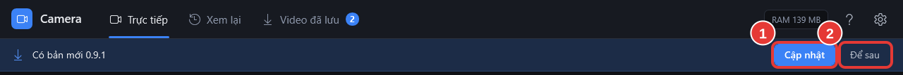

# Cập nhật phần mềm

**Ai làm:** Người xem camera hoặc bộ phận IT · **Mất khoảng:** 1–2 phút

Khoảng 10 giây sau khi mở, phần mềm tự kiểm tra bản mới. Khi có bản mới, thanh **Có bản mới** kèm số phiên bản hiện dưới thanh trên cùng.

<figure><figcaption></figcaption></figure>

1. Bấm **Cập nhật** (1). Phần mềm hiện **Đang tải bản mới…** kèm phần trăm.
2. Khi tải xong, phần mềm hiện **Đang cài bản mới, phần mềm sẽ tự mở lại…**, tự đóng, cài và mở lại.

Bấm **Để sau** (2) nếu đang bận; lần mở sau phần mềm nhắc lại.


**Kết quả:** thông báo **Đã cập nhật lên phiên bản** kèm số phiên bản mới hiện ra. Cài đặt, video và ảnh đã lưu được giữ nguyên.


## Kiểm tra bản mới ngay

Vào **Cài đặt** > khung **Cập nhật và hỗ trợ**, bấm **Kiểm tra bản mới**. Nếu đã là bản mới nhất, phần mềm báo **Đang dùng bản mới nhất** kèm số phiên bản.


Bản mới chỉ được cài sau khi phần mềm kiểm tra file tải về đúng kích thước và mã SHA-256 công bố trên trang phát hành. Danh sách thay đổi của từng bản: [Nhật ký thay đổi](nhat-ky-thay-doi.md).


## Lỗi thường gặp

Không kiểm tra được bản mới. Hãy thử lại khi có mạng.

Máy không vào được Internet hoặc GitHub bị chặn. Camera vẫn xem bình thường vì chỉ cần mạng nội bộ. Thử lại khi có Internet, hoặc báo bộ phận IT cài bản mới bằng bộ cài.

Không cập nhật được. Hãy thử lại sau.

Tải bị gián đoạn hoặc file tải về không khớp nên phần mềm đã bỏ đi. Bấm **Cập nhật** lại sau ít phút.

