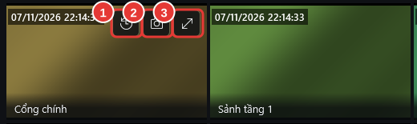

# Chụp ảnh

**Ai làm:** Người xem camera · **Mất khoảng:** vài giây

Bấm **Chụp ảnh** ở một trong ba chỗ:

- Trên lưới camera: để chuột lên ô camera, bấm nút chụp ảnh (số 2 trong hình dưới).
- Khi [xem lớn một camera](xem-lon-mot-camera.md): nút **Chụp ảnh** ở góc trên bên phải.
- Khi [xem lại](../xem-lai/xem-lai-camera.md): nút **Chụp ảnh** bên phải các nút tua. Có thể tạm dừng trước để chụp đúng khoảnh khắc.

<figure><figcaption>
Các nút trên ô camera: (1) Xem lại, (2) Chụp ảnh, (3) Phóng to
</figcaption></figure>


**Kết quả:** thông báo **Đã chụp ảnh** kèm tên camera hiện ra; bấm **Mở ảnh** để xem. Ảnh lưu dạng JPG, đầy đủ độ nét của camera, trong thư mục `Ảnh\Camera` (Pictures\Camera) của tài khoản Windows. Tên file gồm tên camera, ngày và giờ chụp, ví dụ `Cổng chính_2026-11-07_14-30-05.jpg`.


## Lỗi thường gặp

Chưa có hình để chụp. Hãy đợi camera hiện hình rồi thử lại.

Camera chưa lên hình (đang kết nối hoặc mất kết nối). Đợi ô hiện hình rồi bấm lại.

Không lưu được ảnh vào thư mục đã chọn.

Thư mục lưu ảnh không ghi được (ổ mạng mất kết nối, thiếu quyền). Báo bộ phận IT đổi thư mục **Lưu ảnh vào** trong Cài đặt.

