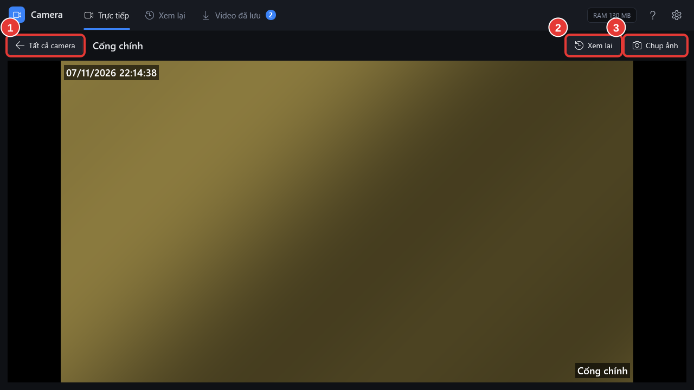

# Xem lớn một camera

**Ai làm:** Người xem camera · **Mất khoảng:** vài giây

1. Ở tab **Trực tiếp**, bấm vào ô camera cần xem. Cũng có thể để chuột lên ô rồi bấm nút **Phóng to** ở góc trên bên phải ô.
2. Camera hiện to, chất lượng cao, tên camera ở bên cạnh nút **Tất cả camera**.

<figure><figcaption></figcaption></figure>

| Số | Nút | Dùng để |
| --- | --- | --- |
| 1 | **Tất cả camera** | Quay lại lưới camera. Nhấn phím `Esc` hoặc bấm đúp vào hình cũng được. |
| 2 | **Xem lại** | Xem lại ghi hình của camera này, bắt đầu từ 5 phút trước. Xem [Xem lại một camera](../xem-lai/xem-lai-camera.md). |
| 3 | **Chụp ảnh** | Lưu ảnh hình đang thấy. Xem [Chụp ảnh](chup-anh.md). |


Hình có thể mất 1–2 giây để chuyển sang chất lượng cao. Camera nhiều điểm ảnh làm máy chạy nặng hơn lưới một chút; quay lại lưới khi xem xong.

