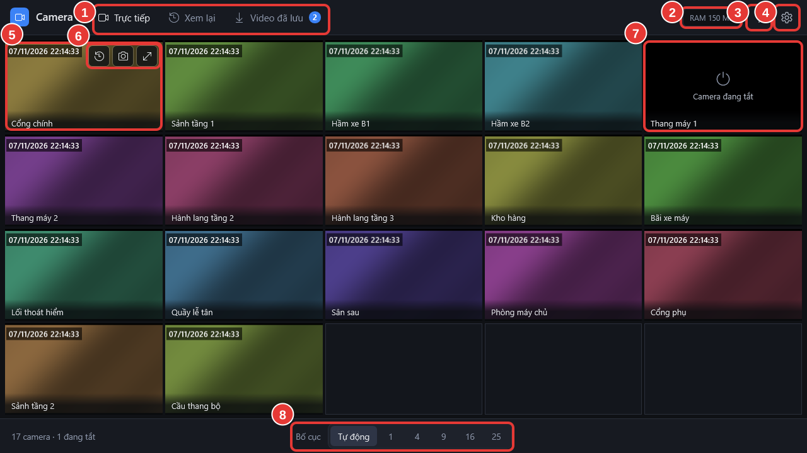

# Xem tất cả camera

**Ai làm:** Người xem camera · **Khi nào:** mỗi lần cần xem camera

1. Mở phần mềm bằng biểu tượng **Camera Viewer** ngoài màn hình. Tab **Trực tiếp** hiện lưới tất cả camera.
2. Chờ 1–2 giây cho các ô lên hình.

Ở chế độ **Tự động**, phần mềm tự chia đủ ô cho mọi camera (ví dụ 17 camera thành lưới 5 cột, 4 hàng). Dòng dưới cùng bên trái cho biết số camera, ví dụ **17 camera · 1 đang tắt**.

<figure><figcaption></figcaption></figure>

## Đổi bố cục

Ở thanh dưới cùng, bấm nút **Bố cục** rồi chọn một kiểu:

- **Tự động**: phần mềm tự chia đủ ô cho mọi camera.
- **Chia đều**: 1, 4, 6, 8, 9, 12, 16 hoặc 25 ô bằng nhau.
- **Khung lớn + khung nhỏ** (1+5, 1+7, 1+12): ô đầu tiên rất to, các ô còn lại nhỏ xếp bên cạnh. Ô to hiện nét hơn các ô nhỏ.

Khi số camera nhiều hơn số ô, hai nút mũi tên **Trang trước** và **Trang sau** hiện ra để chuyển trang.

## Đổi chỗ camera

Có hai cách, thứ tự mới được nhớ cho các lần mở sau:

- **Kéo ô này thả lên ô kia:** hai camera đổi chỗ cho nhau.
- **Kéo từ danh sách camera:** bấm nút **Camera** ở góc dưới bên phải để mở danh sách ở bên phải màn hình. Kéo tên một camera thả vào một ô: ô đó hiện camera ấy, camera cũ của ô đổi chỗ cho camera vừa kéo. Cách này kéo được cả camera đang ở trang khác, và thả được vào ô còn trống. Bấm **Camera** lần nữa hoặc nút đóng để gấp danh sách lại.

## Ẩn camera không cần xem

Rê chuột vào một ô rồi bấm nút **con mắt gạch chéo** ở góc trên bên phải. Camera biến khỏi màn hình Trực tiếp, các ô còn lại dồn lên. Bấm **Hoàn tác** ở thông báo nếu bấm nhầm.

Camera đã ẩn nằm ở nhóm **Đã ẩn** trong danh sách camera. Bấm **Hiện lại** cạnh tên, hoặc kéo nó thả vào một ô: camera hiện lên, camera cũ của ô đó không mất mà xuống cuối danh sách. Màn hình **Xem lại** vẫn thấy đủ mọi camera, kể cả camera đang ẩn.

## Lưu nhiều cách sắp xếp (Bộ)

Một **Bộ** gồm bố cục, thứ tự camera và các camera đang ẩn. Máy luôn có sẵn bộ **Mặc định**, chính là cách sắp xếp bạn đang dùng. Muốn có thêm, ví dụ một bộ **Trực đêm** chỉ có vài camera ở cổng:

1. Sắp xếp màn hình theo ý.
2. Bấm nút **Bộ** ở thanh dưới, bấm **Lưu thành bộ mới…**, gõ tên rồi bấm **Lưu**.
3. Lần sau bấm **Bộ** và chọn tên bộ là cả bố cục lẫn thứ tự camera đổi theo.

Mọi thay đổi bạn làm (đổi bố cục, đổi chỗ, ẩn camera) tự lưu vào bộ đang chọn. Ở menu **Bộ** còn có **Đổi tên** và **Xoá** (hai nút này không dùng được với bộ Mặc định).


Hình trong lưới là hình chất lượng thấp để máy chạy nhẹ. Muốn xem rõ một camera, xem [Xem lớn một camera](xem-lon-mot-camera.md).


## Lỗi thường gặp

Màn hình báo Chưa kết nối đầu ghi

Phần mềm chưa được nhập thông tin đầu ghi, hoặc không liên lạc được với đầu ghi. Bấm **Thử lại**; vẫn không được thì báo bộ phận IT.

Một ô báo Mất kết nối, đang thử lại… mãi không lên

Camera đó hoặc mạng tới camera có vấn đề. Các ô khác vẫn xem bình thường. Báo bộ phận IT tên camera bị lỗi.

