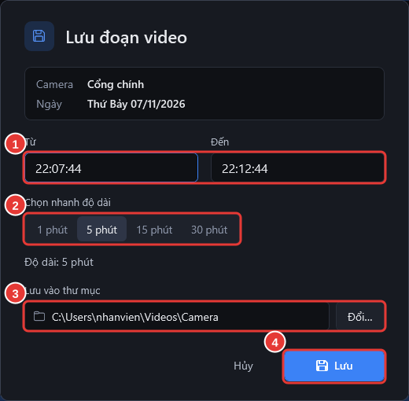

# Trích xuất video

**Ai làm:** Người xem camera · **Mất khoảng:** 1 phút, chưa tính thời gian tải


**Trước khi bắt đầu:** mở camera cần lấy ở tab **Xem lại** và tìm tới đoạn cần lấy. Xem [Xem lại một camera](xem-lai-camera.md).




### Mở bảng Trích xuất video

Khi đang xem tới đoạn cần lấy, bấm nút xanh **Trích xuất video** ở bên phải, cạnh nút **Chụp ảnh**. Bảng **Trích xuất video** mở ra bên phải hình; video vẫn chạy bên cạnh.

Bảng đã điền sẵn 5 phút quanh lúc đang xem: từ 2 phút trước đến 3 phút sau. Đoạn này hiện màu cam trên thanh thời gian. Đúng đoạn cần lấy thì bỏ qua bước 2, bấm luôn **Trích xuất** (3) trong bảng.

<figure><figcaption></figcaption></figure>



### Chỉnh giờ nếu cần

Mỗi giờ đặt được theo hai cách:

- **Lấy từ video:** tạm dừng video đúng lúc bắt đầu, bấm **Giờ đang xem** ở dòng **Từ lúc** (1). Cho video chạy tới lúc kết thúc, bấm **Giờ đang xem** ở dòng **Đến lúc** (2).
- **Gõ giờ:** gõ vào ô, ví dụ `14:30`, `14h30` hoặc `14:30:15`.

Cũng có thể kéo hai đầu đoạn màu cam trên thanh thời gian. Dòng chữ dưới hai ô cho biết đoạn dài bao lâu.



### Bấm Trích xuất

Bấm **Trích xuất** (3) trong bảng. Bảng đóng lại và thông báo **Đang trích xuất video… Xem ở mục Video đã lưu.** hiện ra. Bạn có thể tiếp tục xem camera trong lúc phần mềm làm.




**Kết quả:** khi xong, thông báo **Đã lưu video** kèm tên camera và giờ hiện ra; bấm **Mở video** để xem ngay. File là **MP4**, giữ nguyên chất lượng camera, mở được bằng trình phát video của Windows hay bất kỳ máy nào. Tên file gồm tên camera, ngày và giờ, ví dụ `Cổng chính_2026-11-07_14h30-14h35.mp4`. Theo dõi tiến độ ở [Mở video đã lưu](video-da-luu.md).


Video lưu vào thư mục `Video\Camera` (Videos\Camera) của tài khoản Windows, ghi ở cuối bảng. Đổi thư mục trong [Các mục trong Cài đặt](../tham-khao/cac-muc-cai-dat.md).

Không muốn trích xuất nữa thì bấm dấu **X** ở góc trên bảng hoặc nhấn phím `Esc`. Mỗi lần trích xuất được tối đa 24 giờ video; đoạn dài hơn thì chia làm nhiều lần.

Video trích xuất thường dài hơn đoạn đã chọn vài giây: bắt đầu sớm hơn một chút và kết thúc muộn hơn khoảng 5 giây. Phần mềm cố ý lấy dư như vậy để video không bao giờ thiếu cảnh ở đầu hay cuối đoạn.

## Lỗi thường gặp

Giờ ở bước 2 phải sau giờ ở bước 1.

Giờ ở ô **Đến lúc** sớm hơn hoặc bằng giờ ở ô **Từ lúc**. Sửa lại một trong hai ô.

Gõ giờ như 14:30 hoặc 14:30:15.

Một ô giờ đang trống hoặc có chữ không phải giờ. Gõ lại theo ví dụ, hoặc bấm **Giờ đang xem** bên cạnh ô đó.

Không có ghi hình trong khoảng thời gian này.

Đoạn đã chọn rơi vào khoảng trống trên thanh thời gian. Chọn đoạn nằm trên vạch xanh.

Muốn đóng phần mềm khi đang trích xuất

Phần mềm hỏi lại **Phần mềm đang trích xuất video. Nếu đóng bây giờ, video đang trích xuất sẽ bị hủy.** Chọn không đóng và chờ xong; video dài có thể mất vài phút.

