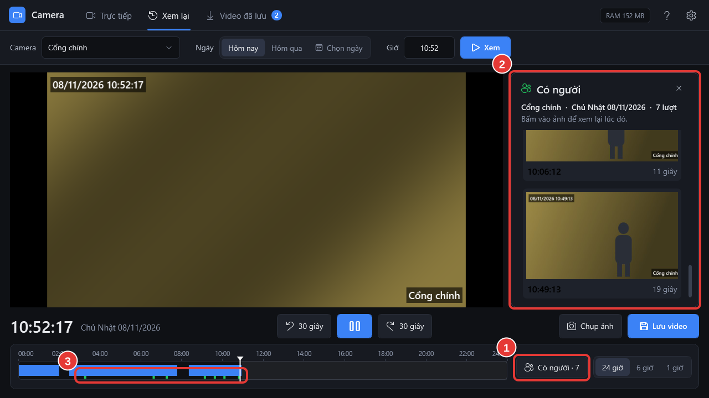

# Tìm lúc có người

**Ai làm:** Người xem camera · **Mất khoảng:** 1 phút

Camera tự nhận ra người. Mỗi lần thấy người, đầu ghi ghi lại giờ và chụp một ảnh. Phần mềm gom các lần đó thành từng **lượt có người**, để bạn khỏi phải tua cả ngày.


**Trước khi bắt đầu:** mở camera và ngày cần xem ở tab **Xem lại**. Xem [Xem lại một camera](xem-lai-camera.md).




### Bấm Có người

Bấm nút **Có người** (1) bên phải thanh thời gian. Số trên nút là số lượt có người trong ngày. Bảng **Có người** (2) mở ra bên phải video, mỗi lượt một ảnh kèm giờ và thời gian người đó ở trong hình.

Những lúc có người cũng hiện thành vạch xanh lá (3) dưới vạch xanh dương trên thanh thời gian.

<figure><figcaption></figcaption></figure>



### Xem ảnh, bấm lượt cần xem

Cuộn danh sách để xem ảnh. Bấm vào ảnh của lượt cần xem: video nhảy tới vài giây trước lúc đó và phát. Bấm lượt khác để xem tiếp.



### Trích xuất nếu cần

Thấy đúng việc cần lấy thì bấm **Trích xuất video** cạnh nút **Chụp ảnh**. Xem [Trích xuất video](luu-doan-video.md).




**Kết quả:** bạn xem được ngay những lúc có người trong ngày mà không phải tua từ đầu. Đổi camera hoặc ngày thì danh sách đổi theo.


Đóng bảng bằng dấu **X** ở góc trên hoặc phím `Esc`. Với hôm nay, mỗi lần mở bảng phần mềm tìm lại để có cả những lượt mới nhất.

Camera nhận người tự động nên có lúc sót (người ở xa, khuất, tối) hoặc nhầm (bóng người, vật giống người). Việc quan trọng thì xem lại video quanh lúc đó cho chắc.

## Lỗi thường gặp

Không thấy nút Có người

Đầu ghi không cho tìm những lúc có người (đời cũ hoặc hãng khác). Vẫn xem lại và trích xuất video bình thường.

Không thấy người nào trong ngày này.

Camera không thấy ai, hoặc camera chưa bật nhận người. Nếu chắc chắn có người qua lại, nhờ bộ phận IT bật **phát hiện chuyển động** với mục tiêu **người** trên camera đó (xem [Xử lý sự cố](../tham-khao/xu-ly-su-co.md)).

Ảnh trong danh sách không hiện

Đầu ghi chưa gửi được ảnh, thường do mạng chậm. Đóng bảng rồi mở lại. Bấm vào lượt đó vẫn xem lại được video.

