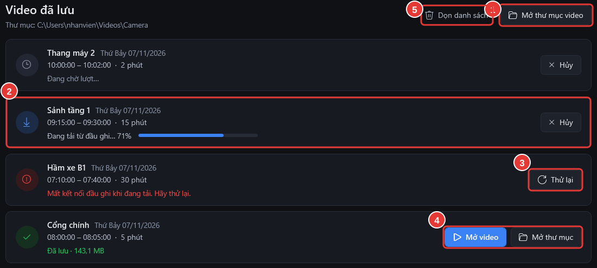

# Mở video đã lưu

**Ai làm:** Người xem camera · **Mất khoảng:** vài giây

Bấm tab **Video đã lưu**. Mỗi video đã yêu cầu lưu là một dòng, mới nhất ở trên, kèm tên camera, ngày, giờ và độ dài.

<figure><figcaption></figcaption></figure>

| Số | Thấy gì | Làm gì |
| --- | --- | --- |
| 1 | Nút **Mở thư mục video** | Mở thư mục chứa mọi video đã lưu. |
| 2 | **Đang chờ lượt…**, **Đang tải từ đầu ghi…**, **Đang hoàn tất video…** kèm thanh tiến độ | Chờ. Mỗi lần phần mềm lưu một video, các video khác chờ lượt. Bấm **Hủy** nếu không cần nữa. |
| 3 | Dòng chữ đỏ báo lỗi và nút **Thử lại** | Đọc lý do, rồi bấm **Thử lại**. |
| 4 | **Đã lưu** kèm dung lượng, nút **Mở video**, **Mở thư mục** | Bấm **Mở video** để xem, **Mở thư mục** để thấy file (ví dụ để chép vào USB hay gửi đi). |
| 5 | Nút **Dọn danh sách** | Bỏ các dòng đã xong khỏi danh sách. Video vẫn còn trong thư mục. |


Danh sách chỉ giữ trong lúc phần mềm mở; đóng phần mềm thì danh sách trống, còn file video vẫn nằm trong thư mục. Video là hình ảnh có người: giữ và chia sẻ theo quy định của đơn vị.


## Lỗi thường gặp

Mất kết nối đầu ghi khi đang tải video.

Mạng hoặc đầu ghi bị gián đoạn giữa chừng. Bấm **Thử lại** khi mạng ổn định.

Ổ đĩa đầy. Giải phóng bớt dung lượng rồi bấm Thử lại.

Ổ đĩa chứa thư mục video đã hết chỗ. Xoá bớt video cũ không cần nữa (hoặc chép sang nơi khác), rồi bấm **Thử lại**.

Không tìm thấy tệp khi bấm Mở video

File đã bị xoá, đổi tên hoặc chuyển đi. Bấm **Mở thư mục video** để tìm lại.

