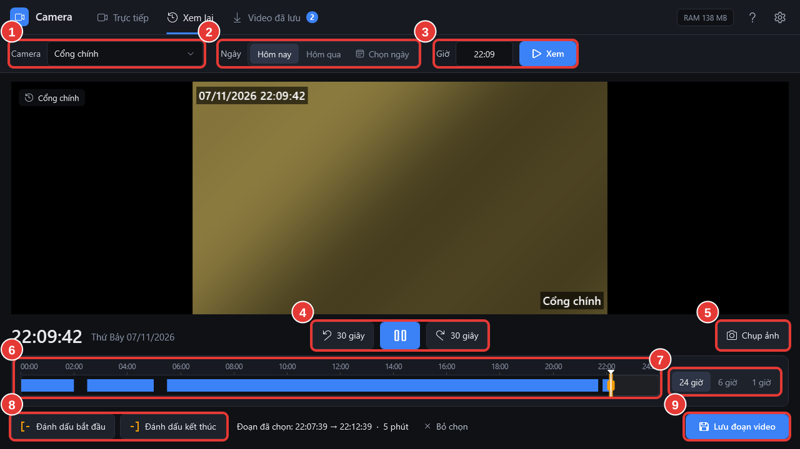

# Xem lại một camera

**Ai làm:** Người xem camera · **Mất khoảng:** 1 phút

<figure><figcaption>
Màn hình Xem lại
</figcaption></figure>



### Mở màn hình Xem lại

Bấm tab **Xem lại**. Cách nhanh hơn: ở lưới camera, để chuột lên ô camera rồi bấm nút **Xem lại**; phần mềm mở đúng camera đó, phát từ 5 phút trước.



### Chọn camera, ngày và giờ

- Ô **Camera** (1): chọn camera cần xem.
- **Ngày** (2): bấm **Hôm nay**, **Hôm qua**, hoặc **Chọn ngày** để chọn trên lịch.
- **Giờ** (3): nhập giờ cần xem theo dạng giờ:phút, ví dụ `14:30`, rồi bấm **Xem**.

Video bắt đầu phát. Đồng hồ lớn bên dưới video cho biết thời điểm đang xem.



### Tua và tạm dừng

Dùng các nút ở giữa (4): **Lùi 30 giây**, **Tạm dừng** / **Phát**, **Tới 30 giây**. Nút **Chụp ảnh** (5) lưu ảnh hình đang thấy.



### Nhảy tới đoạn cần xem trên thanh thời gian

Thanh thời gian (6) hiện cả ngày từ 00:00 đến 24:00. **Vạch xanh là có ghi hình**, chỗ trống là không có. Bấm vào một điểm trên vạch xanh để nhảy tới giờ đó.

Để xem chi tiết hơn, bấm **6 giờ** hoặc **1 giờ** (7), hoặc lăn chuột trên thanh thời gian; kéo thanh sang trái, phải để đi tới giờ khác. Bấm **24 giờ** để xem lại cả ngày.




Nút xanh **Lưu video** (8) lưu một đoạn đang xem ra file MP4: xem [Lưu một đoạn video](luu-doan-video.md). Nút **Có người** (9) liệt kê những lúc camera thấy có người, kèm ảnh: xem [Tìm lúc có người](tim-nguoi.md).


## Phần mềm báo gì khi xem lại

| Thông báo | Nghĩa là |
| --- | --- |
| **Đang tải…** | Phần mềm đang lấy video từ đầu ghi, chờ vài giây. |
| **Không có ghi hình lúc này. Chuyển đến …** | Giờ bạn chọn không có ghi hình; phần mềm tự chuyển tới đoạn có ghi hình gần nhất sau đó. |
| **Ngày này không có ghi hình** | Camera không ghi hình ngày đó. Chọn ngày khác. |
| **Đã hết ghi hình trong ngày này** | Đã xem tới cuối đoạn ghi hình của ngày. |
| **Đã xem đến thời điểm mới nhất** | Đã xem tới hiện tại; muốn xem tiếp thì chuyển sang tab **Trực tiếp**. |

## Lỗi thường gặp

Giờ chưa đúng. Hãy gõ theo dạng giờ:phút, ví dụ 14:30.

Ô **Giờ** cần dạng giờ:phút, dùng dấu hai chấm và giờ 24 tiếng: `09:05`, `14:30`, `21:00`.

Tạm dừng lâu rồi bấm Phát thì báo lỗi

Đầu ghi tự ngắt phiên xem lại nếu tạm dừng quá lâu (thường khoảng 1 phút). Bấm vào vị trí cũ trên thanh thời gian hoặc bấm **Xem** để mở lại.

Không tải được danh sách ghi hình. Hãy thử lại.

Phần mềm không hỏi được đầu ghi. Bấm **Xem** lại sau vài giây; vẫn lỗi thì báo bộ phận IT.

